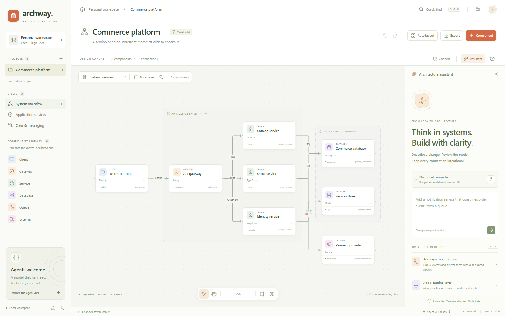

# Archway — Architecture studio

**A visual, model-first software architecture builder for humans and agents.**

The architecture is a typed JSON model. The canvas, inspectors, diagram exports, REST API, and MCP tools all work with that same model. Agents edit semantics and stable IDs—not screenshots or pixels.



> **Status:** working local, single-user MVP, version 0.1.0. The server has no user authentication or project permissions. Do not expose it to the public Internet as-is. Read the [security policy](SECURITY.md) before deploying or connecting a model provider.

## Start here

| I want to…                           | Read                                                                                             |
| ------------------------------------ | ------------------------------------------------------------------------------------------------ |
| Run the application                  | [Quick start below](#quick-start) and [development guide](docs/development.md)                   |
| Understand the system                | [Architecture and source map](docs/architecture.md)                                              |
| Understand the model and operations  | [Model reference](docs/model.md)                                                                 |
| Integrate an agent                   | [Agent integration guide](docs/agent-integration.md) and [API reference](docs/api.md)            |
| Change the code                      | [Contributing guide](CONTRIBUTING.md)                                                            |
| Work as a coding agent               | [Repository agent instructions](AGENTS.md)                                                       |
| Configure an LLM                     | [Configuration reference](docs/configuration.md)                                                 |
| Understand trade-offs and next steps | [Design decision](docs/decisions/0001-model-first-local-first.md) and [roadmap](docs/roadmap.md) |

The [documentation index](docs/README.md) links every guide, example, and generated schema.

## Quick start

Requires **Node.js 22.12+**, npm, and an authorized checkout of this repository. Node.js 24 is the primary development version.

```sh
git clone https://github.com/akshaytp1571/archway-studio.git
cd archway-studio
npm ci
npm run dev
```

Open **http://127.0.0.1:4317**. One server serves the web application, REST API, live events, and MCP endpoint. It is a standalone app, not an extension of a chat GUI.

If another instance is already running, reuse it or choose a different port **and a different data directory**. Do not run two writers against the same data directory. See [safe development commands](docs/development.md).

For a production-mode local build:

```sh
npm run build
npm run start
```

“Production mode” serves compiled assets; it does **not** add authentication or make the app safe to host publicly.

## What is implemented?

- **Visual editor:** six component kinds, labeled relationships, editable views and boundary membership, pan/zoom, minimap, auto layout, keyboard-accessible quick find, and property/connection inspectors.
- **Semantic model:** stable IDs, schema/reference validation, directed dependency/impact analysis, partial view updates that preserve layout, and independent per-view positions.
- **Local projects:** commerce/SaaS/blank templates, atomic file writes, revision checks, undo/redo, bounded history, and named read-only project snapshots with preview/restore.
- **Portable output:** lossless canonical project JSON import/export, SVG image export, and Mermaid text export. Imports create independent projects; SVG and Mermaid are view-only, not round-trip model formats.
- **Assistant:** OpenAI-compatible planning with cancellation, field-level proposal diffs, advisory warnings, explicit apply, and three deterministic recipes that need no LLM. Provider settings include an explicit saved-connection test.
- **Local inventory:** a strict local JSON adapter previews stable-ID additions/updates; no code execution, cloud crawling, or automatic apply. See [inventory](docs/inventory.md).
- **Recovery and measurement:** named snapshots with canonical backup download and atomic restore, plus synthetic maximum-size benchmarks. See [snapshots](docs/snapshots.md) and [performance](docs/performance.md).
- **Agent interfaces:** REST transactions and six official-SDK MCP tools. External edits appear on the canvas through server-sent events; stale inspector drafts are protected.

This is not an infrastructure deployment engine, automatic code/cloud discovery tool, cost estimator, strict C4 interchange implementation, or multi-user collaboration service. The [roadmap](docs/roadmap.md) separates future work from current behavior.

## Try the assistant without a key

Open **Assistant → Add a caching layer**, inspect the preview, then apply the batch. Built-in recipes are explicitly labeled and do not call an LLM.

For free-form prompts, open **Provider settings** and configure an OpenAI-compatible base URL, model, and optional API key. Saving settings does not test connectivity. Use **Test saved connection** for an explicit synthetic request, or generate a proposal. A connection test sends no architecture but may incur provider charges.

**Privacy:** prompts and the current architecture are sent to the configured provider. Keys are kept server-side but stored in a local plain JSON settings document—not an encrypted secrets vault. See [configuration](docs/configuration.md) and [security](SECURITY.md).

## Agent integration in one minute

MCP endpoint:

```text
http://127.0.0.1:4317/mcp
```

Connect a client supporting **Streamable HTTP**. Exact client configuration syntax varies.

```json
{
  "mcpServers": {
    "archway": {
      "type": "http",
      "url": "http://127.0.0.1:4317/mcp"
    }
  }
}
```

Tools: `list_projects`, `get_architecture`, `get_model_schema`, `preview_changes`, `apply_changes`, and `analyze_impact`.

The safe loop is **read → inspect impact → propose → preview → apply**. Always use the current `baseRevision`. A stale batch is rejected; never retry it by changing the revision without re-reading and reviewing the model. The [agent guide](docs/agent-integration.md) has complete REST and MCP examples.

## Verify changes

```sh
npm run verify
npm run test:browser
npm run test:milestones
npm run benchmark
npm run test:performance
```

The first command checks formatting, generated schemas, local documentation links, TypeScript, automated tests, and the client build. Browser tests additionally require a Chromium browser and built web assets. They use isolated temporary projects and a local mock model provider, never a real paid LLM.

```sh
# For a bundled browser, including Linux CI:
npx playwright install chromium
npm run test:browser
```

On Windows, browser tests also discover installed Chrome or Edge. An explicit `ARCHWAY_BROWSER_PATH` takes precedence. See [testing and troubleshooting](docs/development.md).

The owner-approved, commit-pinned [CI workflow](.github/workflows/ci.yml) is included locally alongside the [template](docs/ci/github-actions.yml). It uses read-only repository permissions. Hosted checks run on the configured GitHub push and pull-request triggers. Inspect Actions for current results; local verification is not evidence of a hosted pass. See [CI guide](docs/development.md#github-actions).

## Repository and license status

This repository is **public** under the MIT License. Repository visibility does not change the application's local-only deployment security.

Archway source code and repository documentation are licensed under the [MIT License](LICENSE), copyright 2026 akshaytp1571 and Archway contributors. MIT permits use, modification, distribution, sublicensing, and commercial use, provided the copyright and permission notices are retained. The software is provided without warranty. Third-party dependencies retain their own licenses.

The public source license does not grant access to private user architecture data or change its ownership. Local project data, provider settings, credentials, dependencies, and generated artifacts are excluded from the repository.

See [contributing](CONTRIBUTING.md), [security](SECURITY.md), and the [changelog](CHANGELOG.md).
