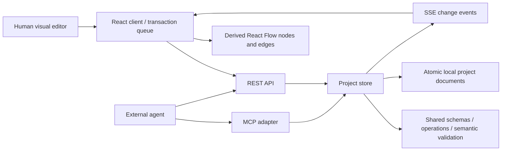

# Architecture and source map

## Core idea

**The diagram is a projection of the architecture model.** Components, relationships, boundaries, and views are stored as typed data. Visual editing and external agents use the same operations and validation rules.

The model-first design decision and deferred hosted-service requirements are recorded in [ADR 0001](decisions/0001-model-first-local-first.md).

## Layers and ownership

| Layer              | Source                                                                           | Responsibility                                                                                   |
| ------------------ | -------------------------------------------------------------------------------- | ------------------------------------------------------------------------------------------------ |
| Canonical model    | [Shared model](../shared/model.ts)                                               | Zod schemas, semantic invariants, immutable batch application, impact traversal                  |
| Templates/recipes  | [Templates](../shared/templates.ts)                                              | Synthetic starter models and explicitly deterministic recipes                                    |
| Layout/geometry    | [Layout](../shared/layout.ts)                                                    | Dagre positions and computed boundary rectangles                                                 |
| Export             | [Export functions](../shared/export.ts)                                          | Escaped SVG and Mermaid generation from a selected view                                          |
| Persistence        | [Project store](../server/store.ts)                                              | Per-project in-process queues, revisions, snapshots, history, atomic writes                      |
| Live notifications | [Live store](../server/live-store.ts)                                            | Emit saved-change events from normal writes and history travel                                   |
| HTTP               | [Application](../server/app.ts)                                                  | REST contracts, request limits, Host/Origin checks, errors, SSE, MCP route                       |
| MCP                | [MCP server](../server/mcp.ts)                                                   | Six official-SDK tools backed by the same store                                                  |
| Model provider     | [Provider integration](../server/provider.ts)                                    | Server-side settings, OpenAI-compatible planning, schema-checked proposals                       |
| Runtime            | [Server entry](../server/index.ts)                                               | Loopback listener, Vite middleware in dev, compiled assets in production mode                    |
| Client state       | [Studio hook](../src/useStudio.ts)                                               | Queue mutations, attach current revisions, accept snapshots, refresh conflicts, subscribe to SSE |
| Visual editor      | [Canvas](../src/Canvas.tsx)                                                      | Derived cards/edges, drag/connect, view switch, preview highlights, pan/zoom                     |
| Product UI         | [App](../src/App.tsx), [panels](../src/Panels.tsx), [dialogs](../src/Modals.tsx) | Workspace, inspector drafts, assistant review/apply, templates, import/export, API guide         |

## Canonical versus derived state

**Persisted semantics:** project metadata, component identities/properties, directed relationships, boundary membership, and view definitions/positions.

**Derived render state:** React Flow card nodes, edge labels/markers, virtual boundary rectangles, highlighting, and temporary drag state. Boundary render IDs are not component IDs.

**Local UI preferences:** selected project/view and interaction state. An agent modifying a view does not change every user's local selection. The model has no global `activeViewId` property.

A view filters components by kind; an empty kind filter means all components. Only relationships whose endpoints are visible are rendered in that view. Layout positions can exist for components not currently visible in a filtered view.

## Saved-change lifecycle

1. The client or agent reads a project and its revision.
2. It prepares a batch of [typed operations](model.md#operations).
3. A preview checks the revision, clones the model, applies the entire batch in memory, and validates it. No save or revision increment occurs.
4. Apply enters the store's per-project queue and rechecks the revision against the latest saved document.
5. The engine constructs and validates a complete proposed model. If any operation or reference is invalid, nothing is persisted.
6. On success, the store saves the previous content for undo, clears redo, increments the revision once, updates the timestamp/history, and writes a temporary file followed by an atomic rename.
7. The live store emits the saved revision. The browser reloads newer snapshots through SSE.

Preview does not reserve a revision. Another actor may commit between preview and apply; the final revision check must still reject that stale batch.

## Persistence boundary

Each project document stores the canonical project plus history and undo/redo content snapshots. The public project/export contracts do not expose that raw storage wrapper.

- Up to 50 normal undo snapshots.
- Up to 200 history events retained; project reads return the latest 80, newest first.
- Undo/redo restores content while advancing the revision; it never decrements the revision.
- A fresh data directory starts with the commerce sample.
- JSON import creates a new project ID and revision zero, preserving component/relationship/view IDs. It is not an overwrite of the current project.

**One writer process per data directory.** Queues are in-process only; there is no distributed lock, database transaction coordinator, or supported multi-process writer setup. Read [security](../SECURITY.md) before backup or deployment decisions.

## Assistant boundary

The assistant first obtains either a deterministic recipe or a provider proposal. Provider responses are parsed into bounded operation batches, schema-checked, checked for prohibited bulk operations, and previewed against the current revision before being returned.

The proposal is not automatically applied. The UI previews the proposed model and requires an explicit apply action. External clients can invoke apply directly, so the recommendation to preview is not a substitute for authorization.

The provider receives semantic architecture context and view summaries, not a screenshot. Recipe mode is explicitly labeled and requires no inference call. No live-provider success is claimed merely because settings were saved.

## Testing boundaries

- [Model tests](../tests/model.test.ts): invariants, patches, cascade behavior, layouts, impact, recipes, exports.
- [API tests](../tests/api.test.ts): persistence, conflicts, concurrent writers, history, Host/Origin checks, SDK MCP calls.
- [Provider tests](../tests/provider.test.ts): real HTTP chat-completions flow against a local mock.
- [Documentation tests](../tests/documentation.test.ts): examples and schema contracts.
- [Browser checks](../tests/browser.ts): visual editing, proposal review/apply, import/export, persistence, external edits, stale drafts, mobile layout.

Browser tests serve isolated built assets and use an OS temporary data store. They do not exercise or overwrite the user's running project.

## Local milestone modules

- [Provider routes](../server/provider-routes.ts) propagate disconnect cancellation and explicit saved-connection testing.
- [Snapshots](../shared/snapshots.ts), [snapshot routes](../server/snapshot-routes.ts), and the [store](../server/store.ts) provide versioned captures and atomic revision-checked restore via the same apply engine.
- [Inventory mapping](../shared/inventory.ts) and [preview route](../server/inventory-routes.ts) only propose validated additions/updates; the normal explicit apply path persists them.
- [Semantic diff](../shared/diff.ts), [proposal review](../src/ProposalDiff.tsx), and [search](../shared/search.ts) remain pure projections/utilities, not another persisted model.
- [Workspace dialogs](../src/WorkspaceModals.tsx) edit view/boundary semantics through the canonical operations. No public-hosting protections were removed.

## Extension checklist

A new semantic feature should start at the shared schema/engine, then flow through storage and both transports, then UI projection, tests, generated references, and documentation. Do not introduce a second model hidden in a canvas adapter or prompt handler.

See [contributing](../CONTRIBUTING.md) and [the roadmap](roadmap.md) for migration, collaboration, authentication, and discovery work that is intentionally deferred.
